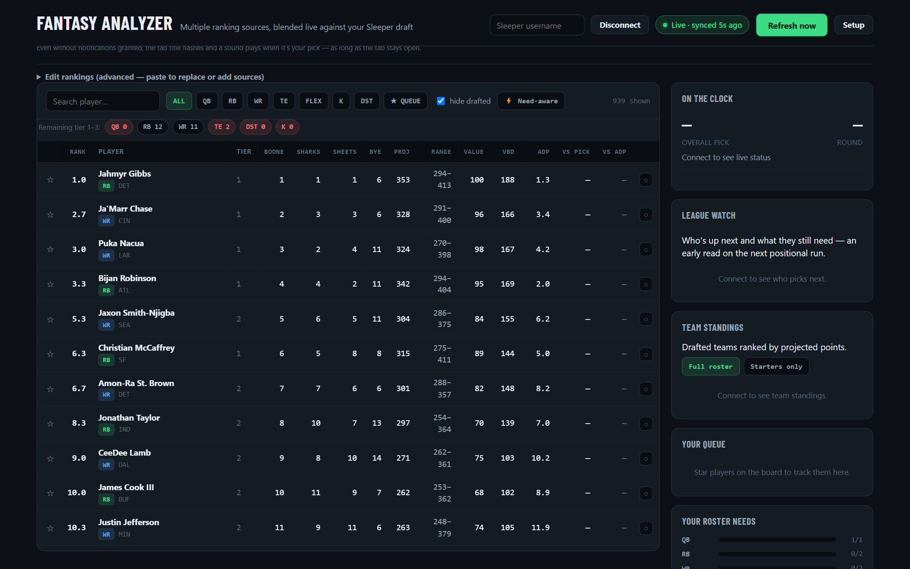
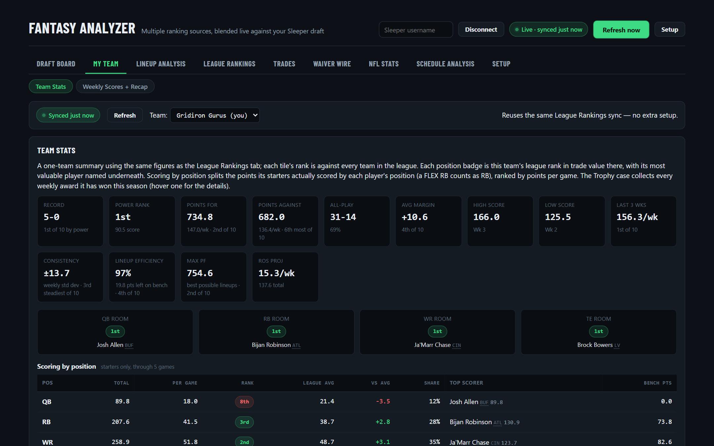
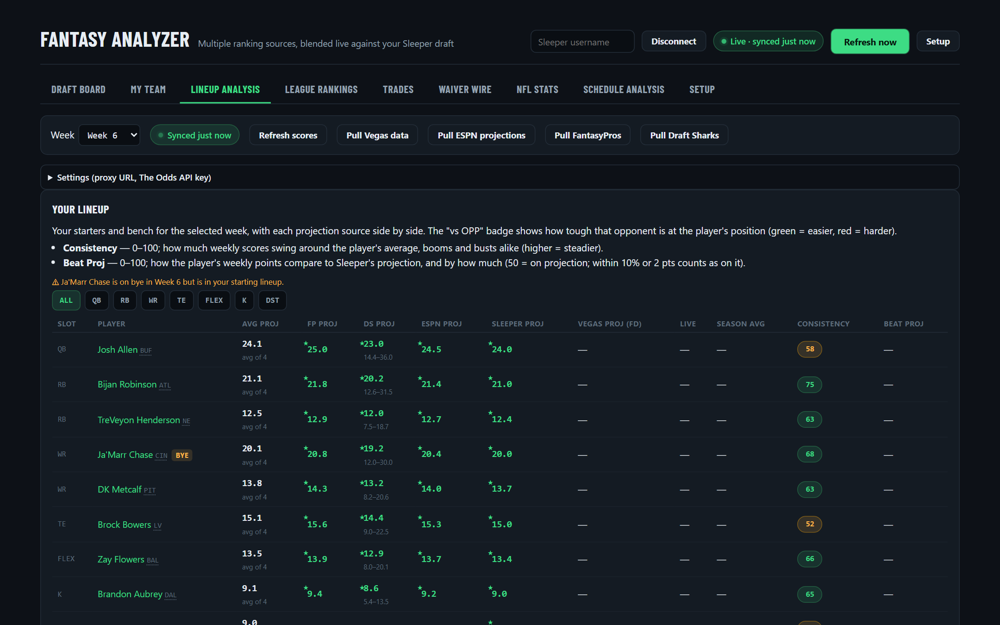
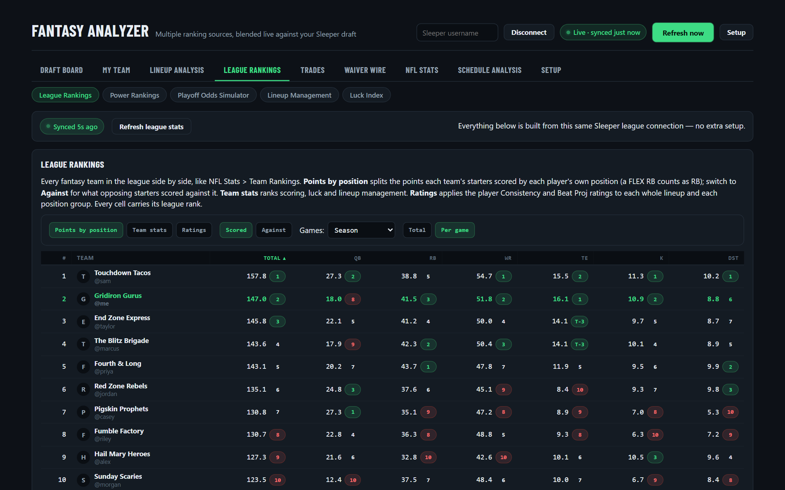
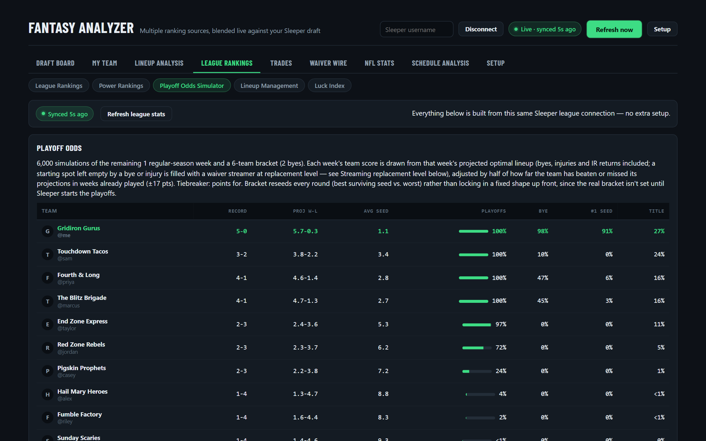
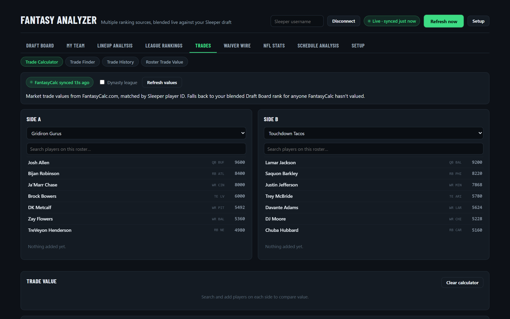

# Fantasy Football Draft Tracker

A personal, non-commercial fantasy football assistant that I built for my own leagues and a small group of friends. It runs entirely in the browser as a single self-contained HTML file: no accounts, no ads, no server-side database.

> **Source code is not public.** This repo only describes the project. I'm happy to give a walkthrough or demo on request.

## What it does

- **Draft Board:** blends several rankings sources into one live board that syncs with the league's draft as picks happen, plus positional-run alerts, roster needs and a pick queue.
- **My Team:** season summary for any team in the league: record, points for and against, all-play record, consistency, lineup efficiency and position-group strength.
- **Lineup Analysis:** weekly start/sit help. Shows several projection sources side by side, averages them, flags bye weeks and suggests better lineup swaps.
- **League Rankings:** ranks every team by position scoring and team stats, plus power rankings, a playoff-odds simulator, lineup-management grades and a luck index.
- **Trades:** a trade calculator using market trade values, a trade finder and trade history.
- **Waiver Wire:** free-agent rankings, streaming suggestions and FAAB bid history.

## Data sources

The tool currently syncs with **Sleeper** leagues through Sleeper's public API. Weekly projections come from public sources (ESPN, FantasyPros, Draft Sharks) and are only fetched when the user clicks a button. They are cached in that user's own browser.

## Planned: Yahoo Fantasy support (read-only)

Many of my friends play on Yahoo, so I'm adding the same features for Yahoo leagues through the Yahoo Fantasy Sports API:

- **Access:** read-only. Each user signs in with their own Yahoo account (OAuth 2.0), and the tool only reads leagues that user belongs to.
- **Data used:** league settings, standings, scoreboard and matchups, teams, weekly rosters, draft results, transactions, and player stats and points.
- **When calls happen:** only when a user opens the tool or clicks refresh. No background polling or scraping.
- **Secrets and tokens:** the app's client secret lives server-side in a small Cloudflare Worker that handles the token exchange. User tokens stay in each user's own browser.
- **Data handling:** no Yahoo data is resold, shared with third parties, or stored on a server.
- **Credit:** the tool displays "Fantasy data provided by Yahoo Fantasy."

## Screenshots

*All screenshots use a made-up demo league. The team names, owners and scores are fictional.*

### Draft Board

### My Team

### Lineup Analysis

### League Rankings

### Playoff Odds Simulator

### Trade Calculator

